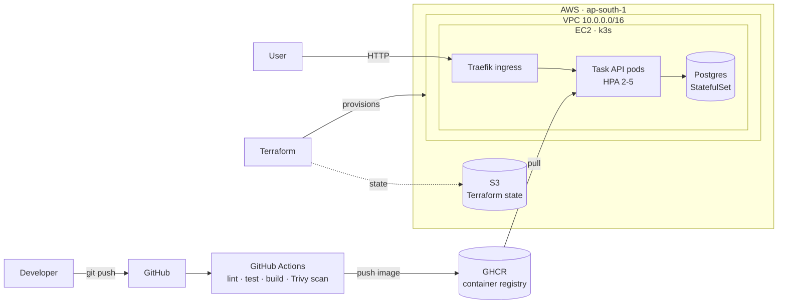

# AWS DevOps Pipeline


End-to-end delivery platform for a small REST API: infrastructure as code on AWS, containerised
builds, CI/CD with security scanning, Kubernetes deployment with autoscaling, and (in progress)
monitoring and incident runbooks.

> **Status:** work in progress — see the [roadmap](#roadmap).

## Architecture



| Layer | Tooling |
|---|---|
| Application | Python, FastAPI, SQLAlchemy, Postgres, Prometheus metrics |
| Infrastructure as code | Terraform (modules, remote S3 state with native locking) |
| Compute | EC2 + k3s (lightweight Kubernetes), Elastic IP, IMDSv2, encrypted EBS |
| Containers | Docker multi-stage build, non-root user, read-only root filesystem |
| CI/CD | GitHub Actions, Trivy image scanning, GitHub Container Registry |
| Deployment | Helm chart, rolling updates with zero downtime, HorizontalPodAutoscaler |

## Repository layout

```
app/                     FastAPI service, tests, Dockerfile
infra/bootstrap/         One-time: S3 bucket for Terraform state
infra/modules/network/   VPC, public/private subnets, routing
infra/modules/k3s-node/  EC2 instance running k3s, security group, Elastic IP
infra/envs/dev/          The dev environment wiring the modules together
deploy/helm/taskapi/     Helm chart: Deployment, Service, Ingress, HPA, Postgres
.github/workflows/       CI (app) and infra checks (Terraform + Helm)
docs/                    Runbook and post-incident report template
```

## Run locally

Requires Docker Desktop.

```bash
docker compose up --build
# API docs: http://localhost:8000/docs
```

Run the tests without Docker:

```bash
cd app
python -m venv .venv && .venv\Scripts\activate      # Windows (macOS/Linux: source .venv/bin/activate)
pip install -r requirements.txt -r requirements-dev.txt
pytest
```

## Deploy to AWS

> **Cost:** while running, the dev environment costs roughly **$20/month** (t3.small + Elastic IP + 20 GB disk).
> Set an [AWS billing alert](https://docs.aws.amazon.com/cost-management/latest/userguide/budgets-create.html)
> first, and run `terraform destroy` when you are not using it.

**Prerequisites** (Windows: `winget install Hashicorp.Terraform Amazon.AWSCLI Kubernetes.kubectl Helm.Helm`)

1. **Configure AWS credentials:** `aws configure` (use an IAM user or IAM Identity Center, never the root account).
2. **Create an SSH key** if you don't have one: `ssh-keygen -t ed25519`
3. **Create the state bucket** (one time):
   ```bash
   cd infra/bootstrap
   terraform init
   terraform apply -var="state_bucket_name=<yourname>-tfstate-<random>"
   ```
4. **Create the environment:**
   ```bash
   cd ../envs/dev
   cp backend.hcl.example backend.hcl            # set your bucket name
   cp terraform.tfvars.example terraform.tfvars  # set allowed_cidr to your IP (curl ifconfig.me)
   terraform init "-backend-config=backend.hcl"   # quotes needed in PowerShell
   terraform plan
   terraform apply
   ```
   k3s takes about 2 minutes to install after the instance starts.
5. **Get cluster access:**
   ```powershell
   $IP = terraform output -raw public_ip
   ssh ubuntu@$IP "sudo cat /etc/rancher/k3s/k3s.yaml" > kubeconfig
   (Get-Content kubeconfig) -replace '127.0.0.1', $IP | Set-Content kubeconfig
   $env:KUBECONFIG = "$PWD\kubeconfig"
   kubectl get nodes
   ```
6. **Publish the image:** push to `main` and the CI workflow pushes `ghcr.io/<you>/aws-devops-pipeline`.
   The image's `org.opencontainers.image.source` label links the package to this public repo, so it is
   public too and the cluster can pull it without credentials.
7. **Deploy:**
   ```bash
   helm upgrade --install taskapi deploy/helm/taskapi \
     --set image.repository=ghcr.io/<you>/aws-devops-pipeline \
     --set image.tag=<git-sha> \
     --set postgres.password=<letters-and-digits>
   curl http://<public_ip>/health
   ```
   For later upgrades, add `--reuse-values` and only change `image.tag`.
8. **Tear down:** `terraform destroy` in `infra/envs/dev`.

## Roadmap

**Stage 1 — Infrastructure as code**
- [x] Network and k3s modules, remote state with locking
- [x] First `terraform apply`
- [ ] RDS Postgres module in the private subnets
- [ ] `terraform plan` on pull requests via GitHub OIDC (no stored AWS keys)

**Stage 2 — Containers**
- [x] Multi-stage, non-root Dockerfile and local docker compose
- [x] Patched 5 HIGH CVEs flagged by Trivy (starlette 0.41.3 → 1.10.0, Debian zlib1g)
- [ ] Record image size before/after the multi-stage build

**Stage 3 — CI/CD**
- [x] Lint, test, build, Trivy scan, push to GHCR
- [x] First green pipeline run
- [x] Trivy action pinned to a commit SHA (supply-chain hardening)
- [ ] Branch protection on `main` requiring CI to pass

**Stage 4 — Kubernetes**
- [x] Helm chart with probes, HPA, zero-downtime rolling updates
- [x] First deployment to the cluster
- [x] Fixed startup race between replicas (advisory lock) and added a startup probe
- [x] Deploying the CI-built image from GHCR
- [x] Zero-downtime rollouts verified under load: ~1% failed requests before the `preStop` fix, 0 after
  (see [runbook](docs/runbook.md#requests-failing-during-a-deploy))
- [ ] GitOps with Argo CD (CI updates the image tag, Argo CD syncs)
- [ ] Database migrations with Alembic as a Kubernetes Job
- [ ] HTTPS with cert-manager and a domain

**Stage 5 — Observability**
- [ ] kube-prometheus-stack (Prometheus + Grafana) via Helm
- [ ] Scrape the app's `/metrics` endpoint
- [ ] Grafana dashboard: request rate, error rate, latency (add a screenshot here)
- [ ] Alerts for 5xx error rate and pod restarts

**Stage 6 — Operations**
- [ ] Complete the [runbook](docs/runbook.md)
- [ ] Break something on purpose and write a [post-incident report](docs/postmortem-template.md)

## Design decisions

<!-- Rewrite these in your own words as you build — interviewers will ask about them. -->

- **k3s on EC2 instead of EKS:** EKS charges about $73/month for the control plane alone. k3s is
  certified Kubernetes, so the same manifests and Helm charts work, at a fraction of the cost.
- **GHCR instead of ECR:** a public GHCR image can be pulled by k3s with no registry credentials.
  Moving to ECR would need a kubelet credential provider.
- **No NAT gateway:** saves about $35/month. The private subnets are reserved for RDS, which
  does not need outbound internet access.
- **S3 native state locking:** Terraform 1.10+ locks state in S3 directly, so no DynamoDB table is needed.
- **Kubernetes API and SSH restricted to one IP:** only HTTP/HTTPS is open to the internet.
- **CI blocks on fixable HIGH/CRITICAL vulnerabilities:** the first real build was blocked by 5 HIGH CVEs,
  which were patched before anything was published.
- **Graceful shutdown with a `preStop` pause:** removing a pod from the Service and stopping its container
  happen in parallel; the pause keeps a terminating pod serving until the ingress stops routing to it.

## What I would improve next

<!-- Fill in as you go: e.g. multi-node cluster, separate staging environment, secrets in AWS Secrets Manager. -->
